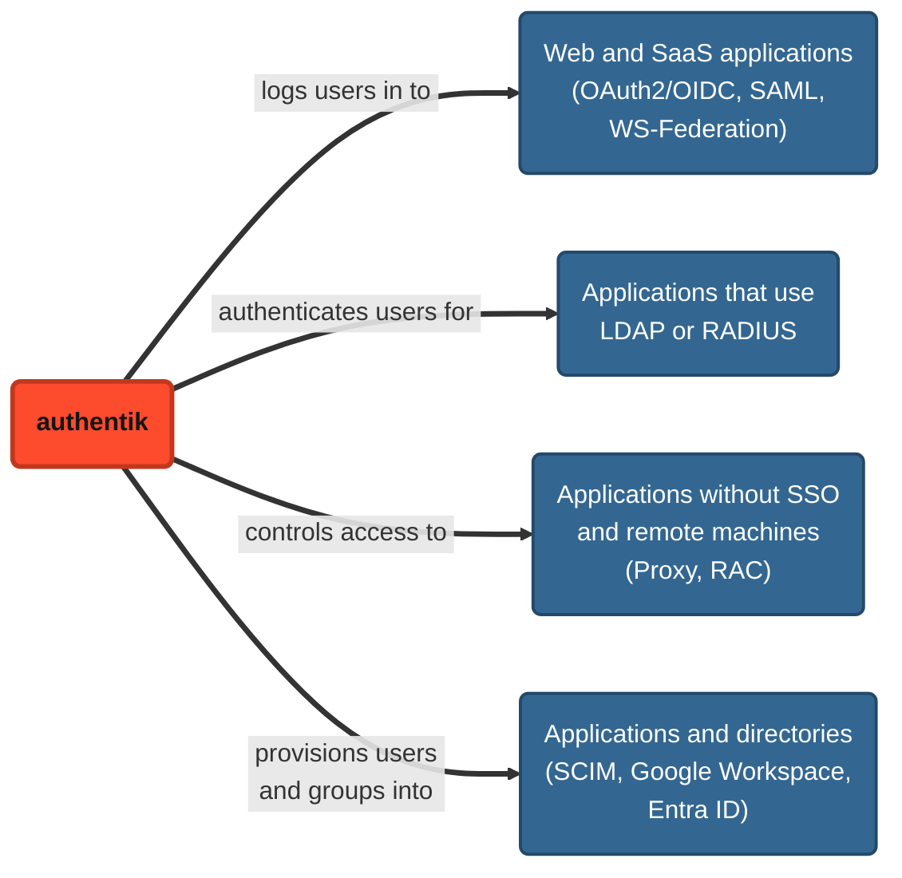

import DocCardList from "@theme/DocCardList";

A provider connects authentik to an application. Most providers let the application log in its users with authentik: authentik acts as the identity provider (IdP), and the application trusts authentik to tell it who the user is. Other providers, such as SCIM, Google Workspace, and Entra ID, provision users and groups from authentik into the application or directory.

To let users log in _to authentik_ with an existing account from another system, such as Google or Entra ID, use a [source](../../users-sources/sources/index.mdx) instead. For more about how sources and providers differ, see [Sources and providers](../../core/concepts.mdx#sources-and-providers).

## How providers work

Providers connect authentik to applications in four main ways:

- **Single sign-on**: with an [OAuth2/OIDC](./oauth2/index.mdx), [SAML](./saml/index.mdx), or [WS-Federation](./wsfed/index.mdx) provider, the application sends users to authentik to log in, and authentik sends them back with their identity. OAuth2/OIDC and SAML providers also support [Single Logout](./single-logout/index.mdx).
- **LDAP and RADIUS**: applications that use [LDAP](./ldap/index.mdx) or [RADIUS](./radius/index.mdx) connect to an [outpost](../outposts/index.mdx), which lets them look up and authenticate authentik users.
- **Proxy and remote access**: an outpost controls access to applications that don't support SSO, through a [Proxy provider](./proxy/index.mdx), or to remote machines over RDP, SSH, or VNC, through a [RAC provider](./rac/index.mdx).
- **Provisioning**: [SCIM](./scim/index.mdx), [Google Workspace](./gws/index.mdx), and [Entra ID](./entra/index.mdx) providers create and update users and groups from authentik in the application or directory.

## Providers and applications

Providers are the "other half" of [applications](../applications/index.mdx). Each application has at most one main provider, and each provider can be the main provider for only one application.

In the Admin interface, you can use the [**New Application** option](../applications/manage_apps.mdx#create-an-application-and-provider-pair) to create a new application and its provider at the same time.

When you create certain types of providers, you need to select specific [flows](../flows-stages/flow/index.mdx), such as an authorization flow, to apply to users who access authentik through the provider. For flows that you don't select, authentik uses the defaults described in [Default flows](../flows-stages/flow/default-flows.mdx).

### Backchannel providers

Applications can use additional providers to augment the functionality of the main provider. For example, an application that uses an OAuth 2.0 provider for login can also use a SCIM provider to provision users. Backchannel providers can be [SCIM](./scim/index.mdx), [LDAP](./ldap/index.mdx), [Google Workspace](./gws/index.mdx), [Entra ID](./entra/index.mdx), or [Shared Signals Framework (SSF)](./ssf/index.mdx) providers. For more information, see [Backchannel providers](../applications/manage_apps.mdx#backchannel-providers).

## Map data to an application

Provider property mappings control which user, group, and other data authentik sends to an application. For example, a SAML property mapping can send a user's groups to an application as a SAML attribute. For more information, see [Provider property mappings](./property-mappings/index.mdx).

## Provider types

For details, see the page for each provider type:

<DocCardList />
