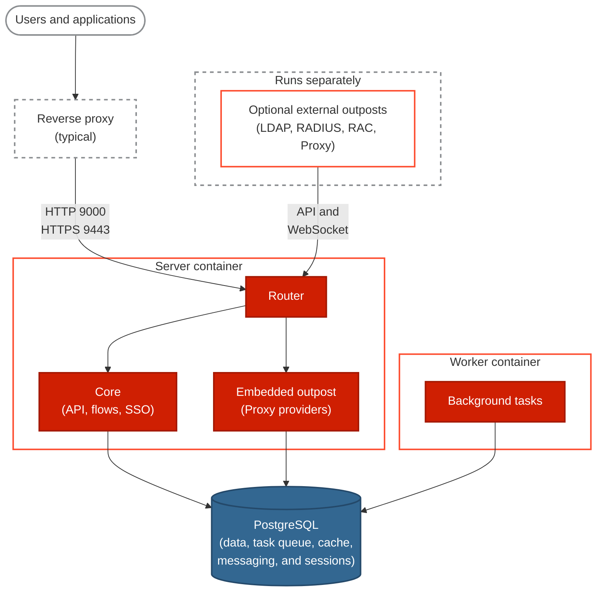

An authentik deployment has three required components: the server, the worker, and a PostgreSQL database. External outposts are optional, and a reverse proxy in front of the server is typical.

The following diagram shows how the components of a deployment connect. Requests reach only the server container. Core, the embedded outpost, and the worker each connect to PostgreSQL, but the server and worker don't connect to each other directly. Optional [external outposts](#external-outposts) run separately and connect to the server through the router.

## Server container

The server container runs three components: a router, _Core_, and the embedded outpost. The router receives every request to the server container, by default on port `9000` for HTTP and `9443` for HTTPS. It sends requests for applications on the embedded outpost to the embedded outpost, serves static files and health checks itself, and forwards all other requests to Core.

If you run authentik behind a reverse proxy, see [Reverse proxy](../install-config/reverse-proxy.mdx) for the required headers and WebSocket support.

### Core

Core runs most of authentik's logic: it serves the [API](/api), executes [flows](../add-secure-apps/flows-stages/flow/index.mdx), and handles SSO requests.

### Embedded outpost

The [embedded outpost](../add-secure-apps/outposts/embedded/embedded.mdx) handles applications that use a [Proxy provider](../add-secure-apps/providers/proxy/index.mdx), so you don't need an [external outpost](#external-outposts) for them. It supports only Proxy providers and stores its sessions in PostgreSQL. For details, see [Routing](../add-secure-apps/outposts/embedded/embedded.mdx#routing). If you don't need it, you can [turn it off](../security/security-hardening.mdx#embedded-outpost).

## Worker container

The worker container runs background tasks, such as sending emails and event notifications. It can also deploy and manage [external outposts](#external-outposts) through the [Docker](../add-secure-apps/outposts/integrations/docker.mdx) or [Kubernetes](../add-secure-apps/outposts/integrations/kubernetes.mdx) integration. For details, see [Worker](../sys-mgmt/ops/worker.mdx).

## PostgreSQL database

authentik stores its configuration and all other data, except uploaded files, in PostgreSQL. PostgreSQL is also the task queue, cache, and messaging layer. The server and the worker don't connect to each other directly; they exchange work only through PostgreSQL. For example, the server queues background tasks, and the worker picks them up. For connection options, see [PostgreSQL settings](../install-config/configuration/configuration.mdx#postgresql-settings).

## File storage

The server and worker share storage for uploaded files, such as icons and flow backgrounds. This is either a `/data` volume mounted into both containers or [S3-compatible storage](../sys-mgmt/ops/storage-s3/index.mdx). For details, see [Files](../customize/files.mdx).

Other mounts are optional, for example for [custom email templates](../add-secure-apps/flows-stages/stages/email/index.mdx#custom-templates), [certificate discovery](../sys-mgmt/certificates.mdx#certificate-discovery), or the [Docker socket](../install-config/install/docker-compose.mdx#docker-socket).

## External outposts

External [outposts](../add-secure-apps/outposts/index.mdx) are optional. You need one only if you use an LDAP, RADIUS, or RAC provider, or if you want to run a Proxy provider outside the server container instead of on the embedded outpost. Each outpost type supports one provider type:

- An [LDAP provider](../add-secure-apps/providers/ldap/index.mdx) serves authentik's users and groups as an LDAP directory, so that applications can authenticate users over LDAP.
- A [RADIUS provider](../add-secure-apps/providers/radius/index.mdx) authenticates users for applications that require RADIUS or don't support any other protocol.
- A [RAC provider](../add-secure-apps/providers/rac/index.mdx) gives users access to remote machines over RDP, SSH, or VNC.
- A [Proxy provider](../add-secure-apps/providers/proxy/index.mdx) protects applications that don't support authentication protocols such as OIDC, SAML, or LDAP.

External outposts run separately from the server and worker, anywhere that can reach the authentik API. They connect through the router and use the API and a WebSocket connection to get their configuration. You can [deploy them manually](../add-secure-apps/outposts/index.mdx#outpost-integrations) or let the [worker](#worker-container) manage them.

## Ports

The following table lists the default ports. You can change them with the [listen settings](../install-config/configuration/configuration.mdx#listen-settings).

| Port   | Container         | Purpose                                                       |
| ------ | ----------------- | ------------------------------------------------------------- |
| `9000` | Server            | HTTP traffic for users, applications, and outposts            |
| `9443` | Server            | HTTPS traffic for users, applications, and outposts           |
| `9000` | Worker            | Health checks only                                            |
| `9300` | Server and worker | Prometheus metrics, not published by the default Compose file |

For health checks and metrics, see [Monitoring](../sys-mgmt/ops/monitoring.mdx).

## Scaling and high availability

You can run multiple server and worker instances and scale them independently. Instances keep their state in PostgreSQL, so if one goes offline, another can take over. All instances need access to the same [file storage](#file-storage), and at least one worker must run to handle scheduled tasks.

For more information, see [High availability](../install-config/high-availability.mdx) and [Autoscaling on Kubernetes](../sys-mgmt/ops/autoscaling/index.mdx).
