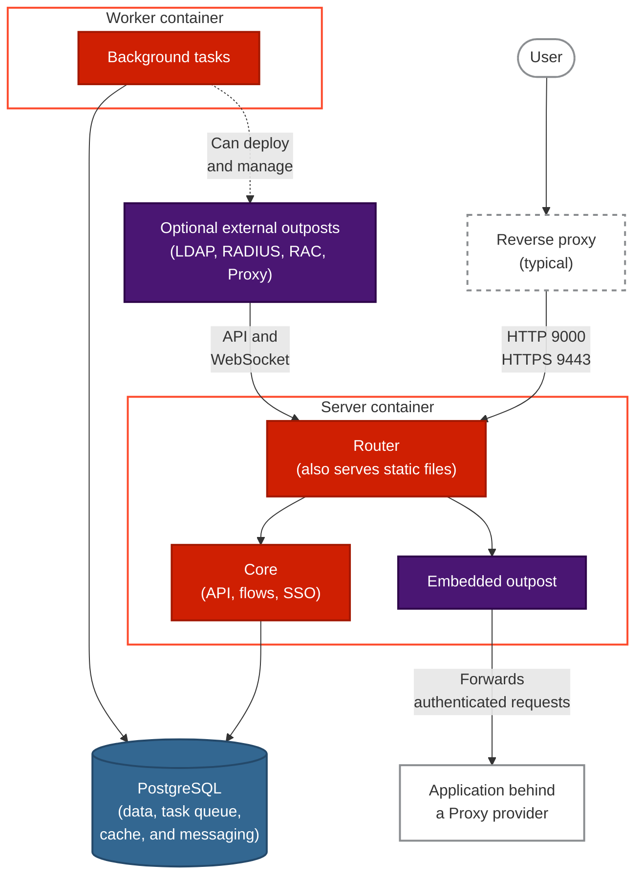

An authentik deployment has three required components: the server, the worker, and a PostgreSQL database. External outposts and some volume mounts are optional, and a reverse proxy in front of the server is typical.

The following diagram shows what runs inside the server and worker containers, how requests reach the server, and how both containers use PostgreSQL.

## Server container

The server container runs three components: a router, _Core_, and the embedded outpost. The router receives all incoming requests to the server container, by default on port `9000` for HTTP and `9443` for HTTPS. If a request's host and path match an application on the embedded outpost, the router sends the request there. The router serves static files, such as JavaScript and CSS files, and the `/-/health/live/` and `/-/health/ready/` health check endpoints itself. It forwards all other requests to Core.

If you expose authentik through a reverse proxy or load balancer, the proxy must set the forwarding headers that authentik requires and support WebSocket connections. For the required configuration, see [Reverse proxy](../install-config/reverse-proxy.mdx).

### Core

Core runs most of authentik's logic: it serves the [API](/api), executes [flows](../add-secure-apps/flows-stages/flow/index.mdx), and handles SSO requests.

### Embedded outpost

The [embedded outpost](../add-secure-apps/outposts/embedded/embedded.mdx) lets you use [Proxy providers](../add-secure-apps/providers/proxy/index.mdx) without deploying an [external outpost](#external-outposts). It handles requests for applications that use a Proxy provider and, in proxy mode, forwards authenticated requests to the application. It reads its configuration from Core's API without leaving the server container. For details about which requests it handles, see [Routing](../add-secure-apps/outposts/embedded/embedded.mdx#routing).

The embedded outpost supports only Proxy providers. LDAP, RADIUS, and RAC providers require an external outpost.

If you don't need the embedded outpost, you can turn it off by setting `AUTHENTIK_OUTPOSTS__DISABLE_EMBEDDED_OUTPOST` to `true`. For more information, see [Security hardening](../security/security-hardening.mdx#embedded-outpost).

### Server persistence

The default [Docker Compose file](../install-config/install/docker-compose.mdx) mounts the following paths into the server container. The [Helm chart](../install-config/install/kubernetes.mdx) doesn't mount storage for uploaded files by default; on Kubernetes, configure the volumes that you need in your Helm values.

- `/data` stores uploaded files (such as icons and flow backgrounds) and CSV reports. The server and worker share this volume. If it isn't mounted, you can't upload files, but you can still use external URLs for icons and other media fields. You can also use [S3-compatible storage](../sys-mgmt/ops/storage-s3/index.mdx) instead of a local volume. For more information, see [Files](../customize/files.mdx) and [File picker values](../customize/file-picker.mdx).
- `/templates` stores [custom email templates](../add-secure-apps/flows-stages/stages/email/index.mdx#custom-templates). This mount is optional.

## Worker container

The worker container runs background tasks, such as sending emails and event notifications. You can see all tasks in the Admin interface under **Dashboards** > **System Tasks**. For details about how the worker picks up and runs tasks, see the [worker documentation](../sys-mgmt/ops/worker.mdx#how-it-works).

The worker can also deploy and manage [external outposts](#external-outposts) through the [Docker](../add-secure-apps/outposts/integrations/docker.mdx) or [Kubernetes](../add-secure-apps/outposts/integrations/kubernetes.mdx) integration. For more information, see [Outpost integrations](../add-secure-apps/outposts/index.mdx#outpost-integrations).

### Worker persistence

The default [Docker Compose file](../install-config/install/docker-compose.mdx) mounts the following paths into the worker container. On Kubernetes, configure the volumes that you need in your Helm values.

- `/data` is the same volume that the server uses for uploaded files and CSV reports.
- `/certs` is the directory that authentik scans to import externally managed certificates, for example from Certbot. For more information, see [Certificate discovery](../sys-mgmt/certificates.mdx#certificate-discovery) and the [Let's Encrypt integration](../sys-mgmt/certificates.mdx#lets-encrypt-integration). This mount is optional.
- `/templates` stores [custom email templates](../add-secure-apps/flows-stages/stages/email/index.mdx#custom-templates). This mount is optional.
- `/var/run/docker.sock` gives the worker access to the local Docker socket, so that authentik can create a [Docker integration](../add-secure-apps/outposts/integrations/docker.mdx) and deploy outposts. This mount is optional. Before you use it, review the security risks described in [Docker socket](../install-config/install/docker-compose.mdx#docker-socket).

## PostgreSQL database

authentik stores its configuration and all other data, except uploaded files, in PostgreSQL. PostgreSQL also serves as authentik's task queue, cache, and messaging layer, so the server and the worker communicate through it. For example, the server queues background tasks in PostgreSQL, and the worker picks them up from there.

### PostgreSQL persistence

- With the default Docker Compose file, the bundled PostgreSQL container stores its database in `/var/lib/postgresql/data`, on a Docker volume named `database`.
- On Kubernetes, with the default Helm chart and the packaged PostgreSQL sub-chart, the database is stored in a PersistentVolumeClaim (PVC). The bundled database is intended for demonstration and test environments. For production, see [PostgreSQL production setup](../install-config/install/kubernetes.mdx#postgresql-production-setup).

To configure the database connection, including TLS, [read replicas](../install-config/configuration/configuration.mdx#read-replicas), and [connection poolers](../install-config/configuration/configuration.mdx#using-a-postgresql-connection-pooler), see the [PostgreSQL configuration reference](../install-config/configuration/configuration.mdx#postgresql-settings).

## External outposts

External [outposts](../add-secure-apps/outposts/index.mdx) are optional. You need one only if you use an LDAP, RADIUS, or RAC provider, or if you want to run a Proxy provider outside the server container instead of on the embedded outpost. Each outpost type supports one provider type:

- An [LDAP provider](../add-secure-apps/providers/ldap/index.mdx) serves authentik's users and groups as an LDAP directory, so that applications can authenticate users over LDAP.
- A [RADIUS provider](../add-secure-apps/providers/radius/index.mdx) authenticates users for applications that require RADIUS or don't support any other protocol.
- A [RAC provider](../add-secure-apps/providers/rac/index.mdx) gives users access to remote machines over RDP, SSH, or VNC.
- A [Proxy provider](../add-secure-apps/providers/proxy/index.mdx) protects applications that don't support authentication protocols such as OIDC, SAML, or LDAP.

External outposts run separately from the server and worker containers and can run anywhere that can reach the authentik API. Each one connects to Core through the router and uses the API and a WebSocket connection to fetch its configuration and receive updates. You can deploy external outposts [manually](../add-secure-apps/outposts/index.mdx#outpost-integrations), or let the [worker](#worker) deploy and manage them.

## Ports

The following table lists the default ports. You can change them with the [listen settings](../install-config/configuration/configuration.mdx#listen-settings).

| Port   | Container         | Purpose                                                       |
| ------ | ----------------- | ------------------------------------------------------------- |
| `9000` | Server            | HTTP traffic for users, applications, and outposts            |
| `9443` | Server            | HTTPS traffic for users, applications, and outposts           |
| `9000` | Worker            | Health checks only                                            |
| `9300` | Server and worker | Prometheus metrics, not published by the default Compose file |

For health checks and metrics, see [Monitoring](../sys-mgmt/ops/monitoring.mdx).

## Scaling and high availability

You can run multiple server and worker instances in parallel and scale them independently. Server and worker instances are stateless because session state and configuration data are stored in PostgreSQL. If one instance goes offline, another instance can take over its work. Uploaded files are the exception: every instance needs access to the same `/data` volume or the same S3-compatible storage. Keep at least one worker running to handle scheduled tasks.

For more information, see [High availability](../install-config/high-availability.mdx) and [Autoscaling on Kubernetes](../sys-mgmt/ops/autoscaling/index.mdx).
