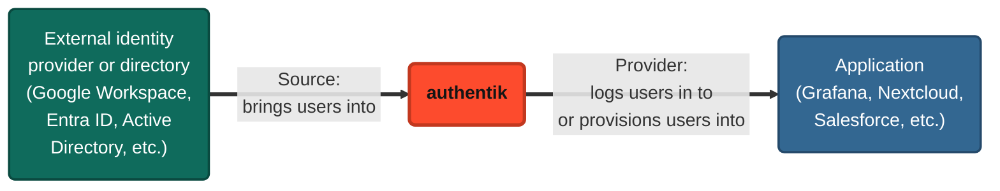

authentik is an identity provider (IdP). It stores or imports user accounts, controls how users log in, and then logs those users in to your applications. This page introduces the main building blocks of authentik and how they fit together.

## Building blocks

- **[Application](../add-secure-apps/applications/index.mdx)**: an application that users access through authentik, such as Grafana or Nextcloud. An application controls who can access it and how it appears on the **Application Dashboard**. Each application has at most one main provider.
- **[Provider](../add-secure-apps/providers/index.mdx)**: connects authentik to an application, to log users in to it or provision users into it. See [Sources and providers](#sources-and-providers).
- **[Source](../users-sources/sources/index.mdx)**: brings users and their data into authentik from an external system. See [Sources and providers](#sources-and-providers).
- **[Flow](../add-secure-apps/flows-stages/flow/index.mdx)**: a sequence of stages that defines a process, such as authentication, enrollment, authorization, or account recovery.
- **[Stage](../add-secure-apps/flows-stages/stages/index.mdx)**: a single verification or logic step within a flow, such as asking for a username, a password, or a multi-factor authentication code.
- **[Policy](../customize/policies/index.mdx)**: a reusable check that controls, for example, whether a user can access an application, whether a stage runs, or whether a user can connect a source to their account.
- **[Outpost](../add-secure-apps/outposts/index.mdx)**: a separately deployed authentik component that runs the logic for LDAP, Proxy, RADIUS, and RAC providers.

## Sources and providers

authentik connects to other systems in two directions:

- A [source](../users-sources/sources/index.mdx) brings users _into_ authentik. Users log in to authentik with an account that they already have in an external identity provider (Google, GitHub, Entra ID, etc.) or a directory (LDAP, Active Directory, etc.). authentik can also import users and groups from a directory, or receive them from another system over SCIM. authentik trusts the external system. Alternatively, you can use local authentik accounts.
- A [provider](../add-secure-apps/providers/index.mdx) connects authentik to an application. Users log in _from_ authentik to the application, using a protocol such as OAuth2/OIDC, SAML, LDAP, or a proxy, and authentik acts as the identity provider (IdP). Some providers, such as [SCIM](../add-secure-apps/providers/scim/index.mdx), [Google Workspace](../add-secure-apps/providers/gws/index.mdx), and [Entra ID](../add-secure-apps/providers/entra/index.mdx), also provision users and groups from authentik into the application. Either way, the application trusts authentik.

You can combine any source with any provider. For example, some users might log in to authentik with their Entra ID account and then access Salesforce through a SAML provider. Other users might log in with a local authentik account and access Nextcloud through an LDAP provider.

## Example: logging in to an application

The following example shows how the building blocks come together to log a user in to an application. In this example, a user who has an Entra ID account opens Grafana:

1. The user opens Grafana, which redirects them to authentik through an OAuth2/OIDC **provider**.
2. The user isn't logged in yet, so authentik runs its authentication **flow**. In the identification **stage**, the user selects the Entra ID **source**.
3. Entra ID authenticates the user and sends them back to authentik, which logs them in.
4. authentik checks the **policies** that are bound to the Grafana **application**.
5. If the user passes the policies, authentik sends them back to Grafana, logged in.
