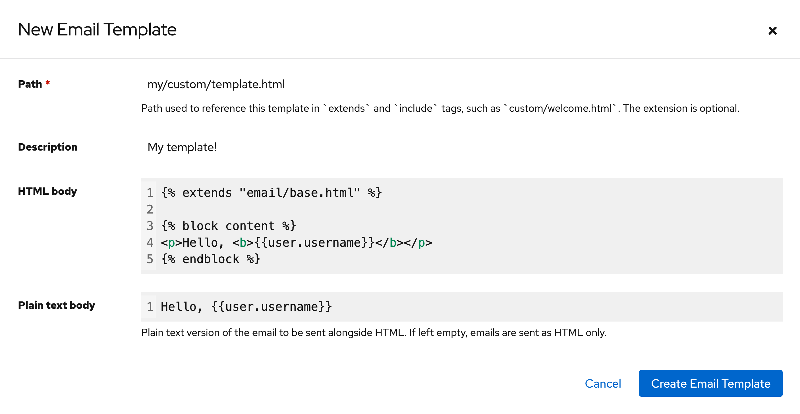
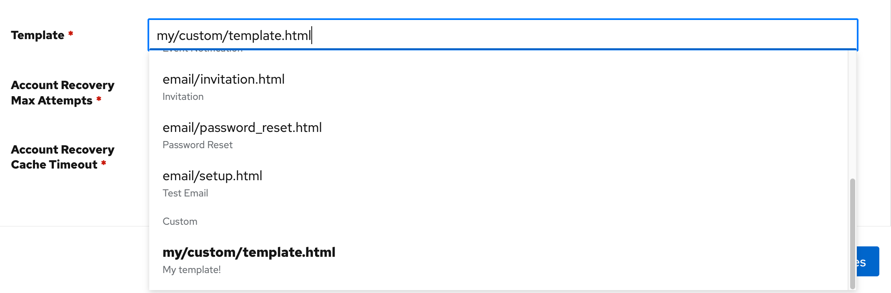

Email templates in authentik are used to define the content of all emails sent, such as password recovery links, one-time codes, invitations, and event notifications. The templates are [Django HTML templates](https://docs.djangoproject.com/en/stable/ref/templates/language/) that are populated with runtime data before being sent.

Email templates are stored in the database and can be managed through **Customization** > **Email Templates** in the Admin interface.

## Create an email template

1. Navigate to **Customization** > **Email Templates** in the Admin interface.
2. Click **New Email Template** at the top of the table.
3. In the dialog, define the necessary template details:
    - **Path**: a unique identifier for the template. this resembles a file path, and can be used by other templates within `` tags.
    - **HTML body**: the HTML email template.
    - **Plain text body**: optionally create a plain text version of the email. this will be sent alongside the HTML and improves deliverability, as well as display on legacy clients.
4. Click **Create Email Template**.



To use the template, select it in the **Template** field of a stage, transport, or invitation email.



### Template variables

Templates are rendered with Django's templating engine. Common variables may include:

- `url`: the full URL the user should open
- `user`: the pending user
- `expires`: when the token expires

### Example template

Templates can extend the base email template and use standard Django template tags. For example:

:::info
Each Django `` tag must stay on one line; a tag wrapped across lines won't parse.
:::

<!-- prettier-ignore -->
```html
{# This comment is not rendered in the final email. #}






<tr>
  <td align="center">
    <h1>
      
      Hi {{ username }},
      
    </h1>
  </td>
</tr>
<tr>
  <td align="center">
    <table border="0">
      <tr>
        <td align="center" style="max-width: 300px; padding: 20px 0; color: #212124;">
          
          You recently requested to change your password for your authentik account. Use the button below to set a new password.
          
        </td>
      </tr>
      <tr>
        <td align="center" class="btn btn-primary">
          <a id="confirm" href="{{ url }}" rel="noopener noreferrer" target="_blank"></a>
        </td>
      </tr>
    </table>
  </td>
</tr>



<tr>
  <td style="padding: 20px; font-size: 12px; color: #212124;" align="center">
    
    If you did not request a password change, please ignore this email. The link above is valid for {{ expires }}.
    
  </td>
</tr>

```
