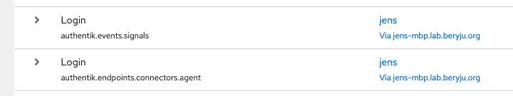

Endpoint devices registered with authentik through a [connector](./connectors/index.mdx), such as the [authentik Agent](./connectors/authentik-agent.mdx) connector, regularly [check in](#device-check-in) with authentik and report their [device facts](#device-facts).

These facts are shown on the [Devices](../manage-devices.mdx) page and are also accessible to policies and can be used to make policy decisions. See [Device Compliance Policy](./device-compliance-policy.mdx) for more details.

## Device check-in

When a device registered with authentik reports its [device facts](#device-facts), this is called a device check-in. These check-ins occur on a regular configurable schedule and can also be set to occur whenever a device is associated with an [Endpoint stage](../../add-secure-apps/flows-stages/stages/endpoint/index.mdx).

authentik keeps the most recent facts that each connector reported for a device, even if the device stops checking in. Older facts are removed 24 hours after newer facts arrive. Because a device keeps its last known facts, a policy that needs current facts should check when they were reported. For example, the following [expression policy](../../customize/policies/types/expression/index.mdx) denies devices whose facts are more than 24 hours old:

```python
from datetime import timedelta
from django.utils.timezone import now

flow_plan = request.context.get("flow_plan")
device = flow_plan.context.get("device") if flow_plan else None
if device is None:
    return False
return device.cached_facts.created > now() - timedelta(hours=24)
```

## Device facts

Device facts are informational snippets about a device, such as its operating system, serial number, installed applications, running processes, and more. These facts are supplied to authentik flows via the [authentik browser extension](browser-extension.mdx) to be used in making policy decisions. For example, you can create a policy that only allows endpoint devices that are running a recent OS version to access an application.

The facts are supplied either by `ak-sysd` or other connectors, and the browser extension is only used to associate the device the user is using with the device record in the authentik database.

### Disk encryption on Linux

On Linux, the authentik Agent reports a disk as encrypted (`encryption_enabled`) in the following cases:

- The filesystem is on dm-crypt/LUKS. With authentik Agent 0.73 and later, this includes LVM and other device-mapper layers, as long as every underlying device is encrypted.
- The filesystem is a ZFS dataset with native encryption enabled, with authentik Agent 0.72 and later. For ZFS datasets, the reported capacity is that of the whole pool.

### Advanced device facts :ak-enterprise

This feature is still in development and will be announced soon.

## Example facts

See [example facts from a Linux device](./facts-linux.json).

## Endpoint devices in event logs

Authentication events involving endpoint devices are included in the [event logs](../../sys-mgmt/events/logging-events.mdx). For example:



### Search for an endpoint device in the event logs :ak-enterprise

To search for event logs matching a specific endpoint device:

1. Log in to authentik as an administrator and open the authentik Admin interface.
2. Navigate to **Events** > **Logs**.
3. In the search bar, enter: `context.device.name = "<device_name>"`

For more information on searching the events logs, see [Logging events](../../sys-mgmt/events/logging-events.mdx).
