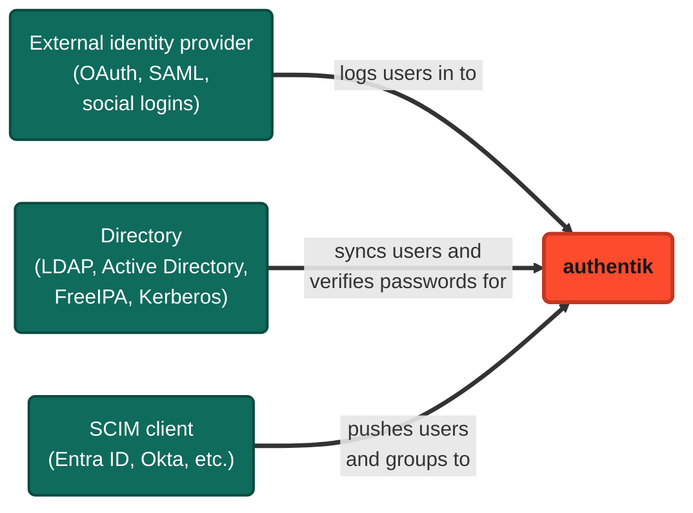

A source brings users _into_ authentik from an external system. With a source, users can log in to authentik with an account that they already have in an external identity provider (Google, GitHub, Entra ID, etc.). authentik can also import users and groups from a directory (LDAP, Active Directory, etc.), or receive them from another system over SCIM.

To let users log in to _other applications_ with their authentik credentials, use a [provider](../../add-secure-apps/providers/index.mdx) instead. For more about how sources and providers differ, see [Sources and providers](../../core/concepts.mdx#sources-and-providers).

## How sources work

Sources bring users into authentik in three ways:

- **Log in with an external account**: users select an [OAuth](./protocols/oauth/index.mdx), [SAML](./protocols/saml/index.mdx), or [social login](./social-logins/index.mdx) source on the authentik login page and log in with the external identity provider. authentik then logs them in, or enrolls them if they are new. For the full sequence, see [How it works](./social-logins/index.mdx#how-it-works).
- **Sync from and log in with a directory**: authentik imports users and groups from an [LDAP](./protocols/ldap/index.mdx) directory, such as [Active Directory](./directory-sync/active-directory/index.mdx) or FreeIPA, or from a [Kerberos](./protocols/kerberos/index.mdx) KDC. If you enable the LDAP or Kerberos backend in the [password stage](../../add-secure-apps/flows-stages/stages/password/index.mdx), users can also log in to authentik with their directory password, such as their Active Directory password.
- **Receive users over SCIM**: another system, such as [Entra ID](./social-logins/entra-id/scim/index.mdx) or Okta, creates and updates users and groups in authentik through a [SCIM source](./protocols/scim/index.mdx).

## Find your source

Sources are in the following general categories:

- **Protocols** - [Kerberos](./protocols/kerberos/index.mdx), [LDAP](./protocols/ldap/index.mdx), [OAuth](./protocols/oauth/index.mdx), [SAML](./protocols/saml/index.mdx), and [SCIM](./protocols/scim/index.mdx)
- **Directory synchronization** - [Active Directory](./directory-sync/active-directory/index.mdx) or [FreeIPA](./directory-sync/freeipa/index.mdx)
- **External identity providers** - including social logins like [Apple](./social-logins/apple/index.mdx), [Discord](./social-logins/discord/index.mdx), [Entra ID](./social-logins/entra-id/index.mdx), [Google](./social-logins/google/index.mdx), [X](./social-logins/twitter/index.mdx), and [many others](./social-logins/index.mdx)

## Add a source

In the Admin interface, sources are under **Directory** > **Federation and Social login**. To add a source, click **Create**, select the source type, and then follow the guide for that source type.

Several source types also expose an **Icon** field that uses the shared file picker. See [File picker values](../../customize/file-picker.mdx).

## Map data from a source

Source property mappings control how authentik handles the user and group data that it receives from a source. If the default mappings don't meet your needs, you can create custom property mappings to modify that data or to gather additional data from the source.

For more information, refer to [Source property mappings](./property-mappings/index.mdx).

## Add sources to default login page

To show sources on the default login screen, add them to the flow. The process below assumes that you have not created or renamed the default stages and flows.

1. Log in to authentik as an administrator and open the authentik Admin interface.
2. Navigate to **Flows and Stages** > **Flows**.
3. Click the **default-authentication-flow**.
4. Click the **Stage Bindings** tab.
5. Click **Edit Stage** on the **default-authentication-identification** stage.
6. Under **Source settings**, add sources to **Selected Sources** to have them displayed on the authentik login page.

## Bind a policy to a source

You can bind a policy to a source to control which users can connect the source to their authentik account. If a user doesn't pass the source's policies, the source doesn't appear under [**Connected services**](../user/user-interface.mdx#connected-services) in their user settings. These policies don't control whether users can log in or enroll through the source.

For instructions, refer to [Bind a policy to a source](../../customize/policies/working_with_policies.mdx#bind-a-policy-to-a-source).
