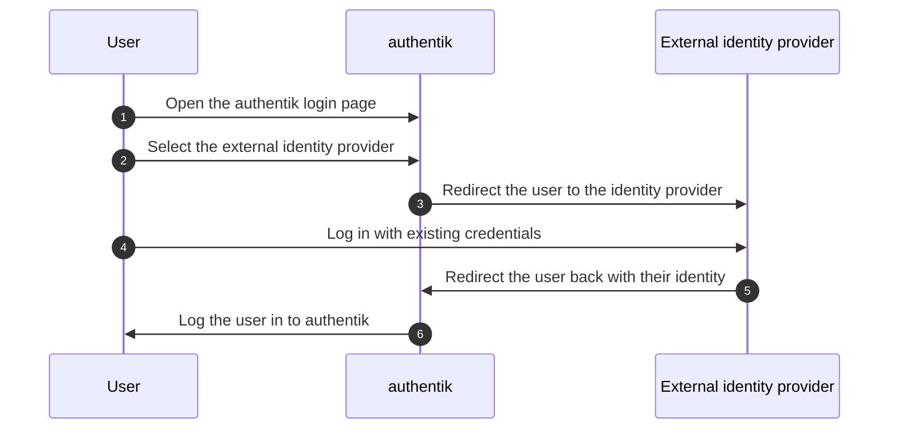

Configuring authentik with an external identity provider, also called a federated identity provider, allows users to log in to authentik with their existing accounts, such as social logins or enterprise identity providers.

For example, a user can log in to authentik using their Entra ID or Google Workspace account.

External identity providers are configured as [sources](../index.mdx). To let users log in to _other applications_ with their authentik credentials, use a [provider](../../../add-secure-apps/providers/index.mdx) instead.

Typically, identity providers use protocols such as [OAuth 2.0](https://en.wikipedia.org/wiki/OAuth) or [Security Assertion Markup Language](https://en.wikipedia.org/wiki/Security_Assertion_Markup_Language) (<abbr>SAML</abbr>). These protocols allow authentik to act as a service provider (<abbr>SP</abbr>) or relying party, delegating the authentication process to the identity provider (<abbr>IdP</abbr>). The choice of protocol depends on what the identity provider supports and the level of integration desired.

## How it works

The following diagram shows a typical login with an external identity provider:

Some SAML identity providers can also start the login themselves, for example from an app portal. For details, see [SP-initiated and IdP-initiated login](../protocols/saml/index.mdx#sp-initiated-and-idp-initiated-login).

## What you can do with a source

When a user returns from the external identity provider, authentik decides what to do based on the source's settings and on whether it already knows the user:

- **Log in to authentik**: if the user has used this source before, authentik runs the source's **Authentication flow**.
- **Enroll in authentik**: if no matching authentik user exists, authentik runs the source's **Enrollment flow**, which typically creates the user and logs them in. If the source has no enrollment flow, new users can't enroll through it.
- **Link an existing authentik account**: users who are already logged in to authentik can connect the source to their account under [**Connected services**](../../user/user-interface.mdx#connected-services). The source's **User matching mode** setting can also link users to an existing authentik account that has the same email address or username, or deny them when such an account exists.

:::warning
Linking by email address or username can have security implications, for example when the identity provider doesn't verify email addresses or when the same username is used with another source.
:::

You can also use sources outside the login page:

- **Within another flow**: the [Source stage](../../../add-secure-apps/flows-stages/stages/source/index.mdx) sends the user to an OAuth or SAML source partway through a flow, and then resumes the flow.
- **Machine-to-machine authentication**: an OAuth2 provider can accept JWTs that were issued by the identity provider of an OAuth source. For details, see [Externally issued JWTs](../../../add-secure-apps/providers/oauth2/machine_to_machine.mdx#externally-issued-jwts).

## Configure authentik

While we provide detailed guides for popular services such as Google, GitHub, and Microsoft Entra ID, you can configure any standards-compliant identity provider using the same basic process.

authentik supports most identity providers that implement standard OAuth 2.0 or SAML 2.0 protocols. While each identity provider may have its own administrative interface, the core information needed is consistent, typically OAuth client credentials or SAML metadata. For an identity provider without a dedicated guide, use the generic [OAuth source](../protocols/oauth/index.mdx) or [SAML source](../protocols/saml/index.mdx).

Our service-specific guides walk you through any unique steps needed for each service.

## See also

- [Log in to authentik with Google](./google/index.mdx)
- [Sources and providers](../../../core/concepts.mdx#sources-and-providers)
- [Providers](../../../add-secure-apps/providers/index.mdx), to let applications log users in with authentik

## External references

- [Federated Identity](https://en.wikipedia.org/wiki/Federated_identity)
- [Social Login](https://en.wikipedia.org/wiki/Social_login)
- [OAuth](https://en.wikipedia.org/wiki/OAuth)
- [SAML](https://en.wikipedia.org/wiki/Security_Assertion_Markup_Language)
